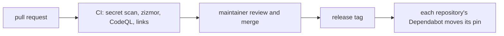

# Vercroft .github

[](https://github.com/Vercroft/.github/actions/workflows/ci.yml)

Vercroft's shared repository: the reusable full-history secret scan every repository calls, and the default
[SECURITY.md](SECURITY.md) and [CONTRIBUTING.md](CONTRIBUTING.md) for repositories that have none of their own.

## How a change ships



## Quick start

Every repository copies this file as `.github/workflows/secret-scan.yml` and keeps its own `.gitleaks.toml` at its root.
Nothing else is needed. Dependabot keeps the commit SHA and the version comment up to date.

```yaml
name: Secret scan

on:
  pull_request:

permissions: {}

concurrency:
  group: secret-scan-${{ github.event.pull_request.number }}
  cancel-in-progress: true

jobs:
  secret-scan:
    name: Secret scan
    uses: Vercroft/.github/.github/workflows/reusable-secret-scan.yml@<commit SHA> # <version tag>
    permissions:
      contents: read
```

GitHub reports the check as `Secret scan / Full history`, and that is the required check. The check name, the file path
and the inputs are this workflow's interface, so changing any of them is a major version.

The one input, `runs-on`, is the job's `runs-on` value as JSON (default `'"ubuntu-latest"'`); to pin a runner group,
add `with:` and `runs-on: '{"group":"my-group","labels":["self-hosted"]}'` to the job.

Working on this repository: install the commit hook with `pre-commit install`.

## More

The rules: [Engineering Practices](https://github.com/Vercroft/engineering-practices). Changes:
[CHANGELOG.md](CHANGELOG.md).

## Licence

MIT, see [LICENSE](LICENSE).
