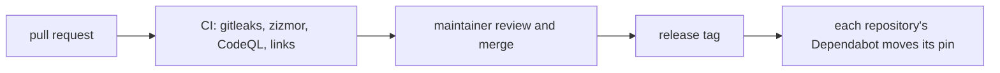

# Vercroft .github

[](https://github.com/Vercroft/.github/actions/workflows/ci.yml)

Vercroft's shared repository: the reusable full-history secret scan every repository calls, and the default
[SECURITY.md](SECURITY.md) and [CONTRIBUTING.md](CONTRIBUTING.md) for repositories that have none of their own.

## How a change ships



## Quick start

Every repository copies this file as `.github/workflows/gitleaks.yml` and keeps its own `.gitleaks.toml` at its root.
Nothing else is needed. Dependabot keeps the commit SHA and the version comment up to date.

```yaml
name: Secret scan

on:
  pull_request:

permissions: {}

concurrency:
  group: gitleaks-${{ github.event.pull_request.number }}
  cancel-in-progress: true

jobs:
  gitleaks:
    name: gitleaks
    uses: Vercroft/.github/.github/workflows/gitleaks.yml@<commit SHA> # <version tag>
    permissions:
      contents: read
```

A private repository may add `with:` and `runner: <its runner value>` to the job; the default is `ubuntu-latest`.

Working on this repository: install the commit hook with `pre-commit install`.

## More

The rules: [Engineering Practices](https://github.com/Vercroft/engineering-practices). Changes:
[CHANGELOG.md](CHANGELOG.md).

## Licence

MIT, see [LICENSE](LICENSE).
